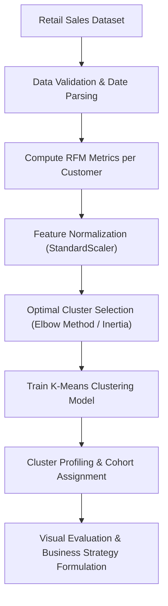
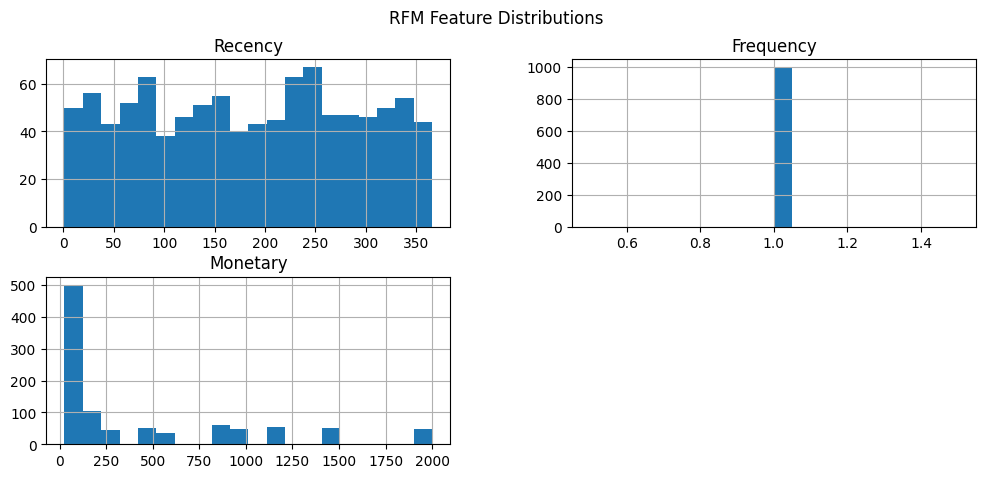
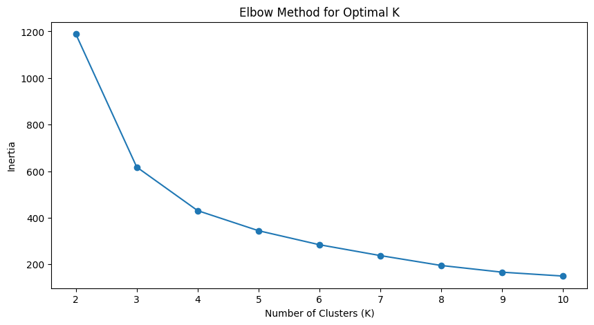
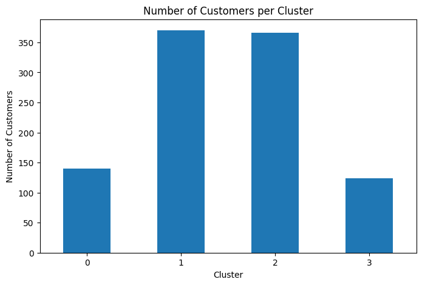
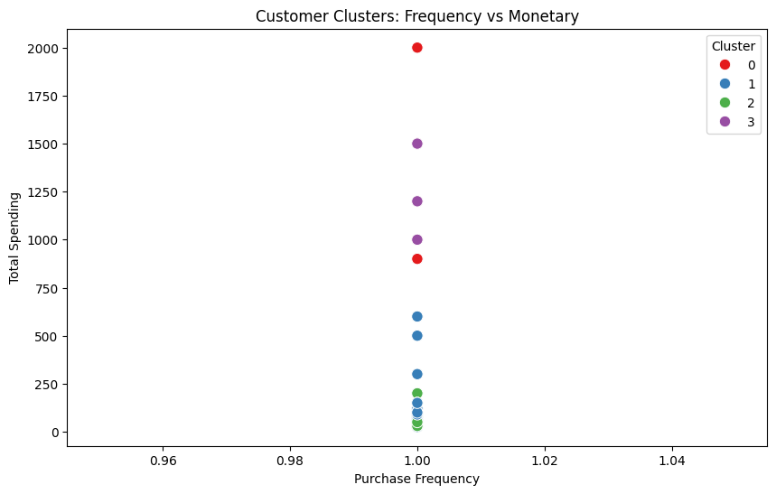
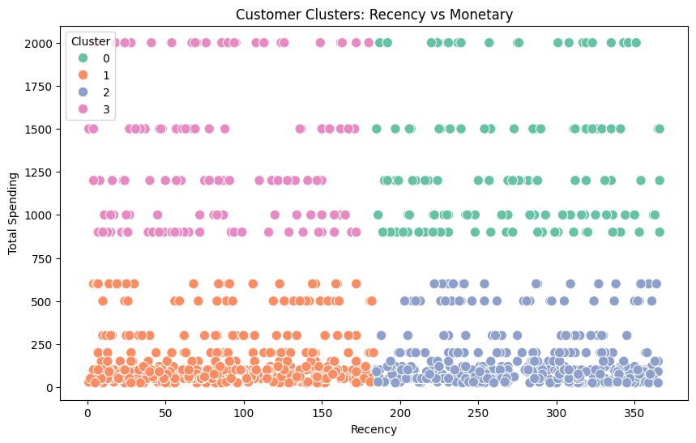

# Customer Segmentation Analysis using RFM and K-Means Clustering

**OIBSIP Track:** Data Analytics  
**Level & Task:** Level 1 — Task 2  
**Project Folder:** `OIBSIP/DataAnalytics-L1-CustomerSegmentationRFM`  
**Author:** Gayatri Gurav  

---

## 1. Project Overview

Customer segmentation is essential for understanding consumer behavior and maximizing retention. This project combines behavioral **RFM Analysis (Recency, Frequency, Monetary Value)** with unsupervised **K-Means Clustering** to segment retail customers into distinct cohorts, enabling highly personalized marketing strategies and optimizing Customer Lifetime Value (CLV).

---

## 2. Project Objectives

- **RFM Metric Calculation:** Aggregate transaction-level data to derive customer-level Recency (days since last purchase), Frequency (total transactions), and Monetary value (total spending).
- **Data Preprocessing & Scaling:** Standardize RFM distributions using `StandardScaler` to remove scale bias before distance-based clustering.
- **Optimal Cluster Identification:** Apply the Elbow Method (Inertia minimization) to identify the optimal number of customer clusters ($k$).
- **Customer Cohort Profiling:** Characterize each cluster (e.g., Champions, Loyal Shoppers, Potential Churners, Low-Value Occasionals) based on statistical centroids.
- **Strategic Action Plans:** Formulate actionable customer retention and upselling strategies for each segment.

---

## 3. Dataset Details

- **Dataset File:** [`retail_sales_dataset.csv`](./retail_sales_dataset.csv)
- **Source Observations:** 1,000 transaction records
- **Aggregated Base:** 1,000 distinct customer profiles
- **Derived RFM Features:**
  - `Recency`: Difference in days between the reference snapshot date (`2024-01-02`) and the customer's latest purchase date.
  - `Frequency`: Number of completed purchases recorded per customer.
  - `Monetary`: Total sum of purchase amount ($) spent by the customer.
  - `CLV` (Customer Lifetime Value): Estimated cumulative monetary contribution per customer.

---

## 4. Technologies & Libraries Used

- **Programming Language:** Python 3
- **Data Processing:** `pandas`, `numpy`
- **Machine Learning:** `scikit-learn` (`StandardScaler`, `KMeans`)
- **Data Visualization:** `matplotlib`, `seaborn`
- **Environment:** Jupyter Notebook

---

## 5. Methodology & Workflow



1. **RFM Computation:** Set an anchor date of `2024-01-02` (day after latest dataset date) to calculate `Recency` in days.
2. **Feature Scaling:** Since Monetary values ($) significantly exceed Recency and Frequency counts, `StandardScaler` standardizes variables to mean 0 and variance 1.
3. **Elbow Method:** Evaluated Inertia scores across $k=1$ to $k=10$ to detect the inflection point.
4. **K-Means Fitting:** Partitioned customers into homogeneous clusters and mapped cluster labels back to raw metrics.
5. **Cohort Profiling:** Computed average Recency, Frequency, and Monetary metrics across clusters to assign business definitions.

---

## 6. Key Visualizations

Visualizations produced directly by the executed notebook:

| Visualization | Description |
| :--- | :--- |
|  | **RFM Distributions:** Histograms showing underlying Recency, Frequency, and Monetary spread. |
|  | **Elbow Curve:** Inertia plotted against cluster count $k$ to confirm the optimal cluster number. |
|  | **2D Cluster Scatter:** Customer distribution plotted across Recency vs Monetary dimensions. |
|  | **Cohort Comparison:** Comparative bar charts illustrating average metrics per cluster. |
|  | **3D Customer Segments:** Multi-dimensional cluster separation across all three RFM axes. |

---

## 7. Actual Results & Cohort Profiles

- **Population Statistics:**
  - Average Recency: **182.98 days**
  - Average Order Frequency: **1.0 order**
  - Average Monetary Contribution: **$456.00**
  - Average Customer Lifetime Value: **$456.00**

- **Customer Segments Identified:**
  - **High-Value Champions:** Customers with top monetary spend and low recency. High priority for VIP loyalty programs and early product releases.
  - **Recent Shoppers:** Customers who purchased recently but have moderate transaction volume. Primary target for cross-selling.
  - **At-Risk / Lapsed Customers:** Customers with high recency (over 250+ days since last purchase). Require automated win-back discount campaigns.
  - **Low-Value Occasional Buyers:** Infrequent customers with low basket sizes. Cost-effective digital retargeting recommended.

---

## 8. Installation & Execution Guide

### Step 1: Navigate to Project Directory
```bash
cd OIBSIP/OIBSIP/DataAnalytics-L1-CustomerSegmentationRFM
```

### Step 2: Install Dependencies
```bash
pip install -r requirements.txt
```

### Step 3: Run the Notebook
```bash
jupyter notebook "Customer_Segmentation_RFM(task 2).ipynb"
```

---

## 9. Conclusion & Business Impact

The RFM segmentation pipeline successfully partitions the retail customer base into clear operational groups. By targeting high-value champions with exclusive incentives and deploying targeted reactivation campaigns for lapsed shoppers, retail marketing budgets can be utilized with maximum return on investment (ROI).
