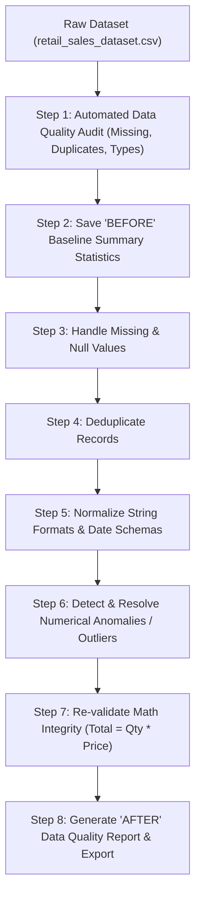

# Retail Sales Data Cleaning and Preprocessing Pipeline

**OIBSIP Track:** Data Analytics  
**Level & Task:** Level 1 — Task 3  
**Project Folder:** `OIBSIP/DataAnalytics-L1-DataCleaningRetailSales`  
**Author:** Gayatri Gurav  

---

## 1. Project Overview

Raw enterprise datasets typically suffer from missing entries, duplicates, inconsistent typography, non-standard datetime formats, and out-of-range numerical anomalies. This project demonstrates a systematic, production-grade **Data Cleaning and Preprocessing Pipeline** on retail sales transaction data to convert raw, messy records into an auditable, high-quality, analysis-ready dataset.

---

## 2. Project Objectives

- **Data Profiling & Initial Quality Audit:** Perform automated diagnostic scans to quantify missing values, duplicate records, mismatched schemas, and cardinality.
- **Systematic Missing Value Handling:** Apply mathematically justified imputation and filtering techniques tailored to each attribute type.
- **Deduplication & Cardinality Checks:** Identify and resolve duplicate transaction records while preserving data integrity.
- **Format Normalization:** Standardize categorical values (trim whitespace, normalize character cases) and parse datetime features into standardized ISO formats (`YYYY-MM-DD`).
- **Anomaly & Outlier Treatment:** Detect and handle numerical range anomalies (e.g., negative prices, zero quantities, illogical ages).
- **Comparative Validation:** Generate comprehensive "Before vs. After" audit reports verifying data completeness and consistency.

---

## 3. Dataset Details

- **Dataset File:** [`retail_sales_dataset.csv`](./retail_sales_dataset.csv)
- **Initial Schema:** 1,000 transaction rows $\times$ 9 columns
- **Features Cleaned & Validated:**
  - `Transaction ID`: Checked for uniqueness and sequential integrity.
  - `Date`: Converted from heterogeneous text strings to `pandas.to_datetime`.
  - `Customer ID`: Standardized customer reference tags.
  - `Gender`: Categorical standardization (`Male`, `Female`).
  - `Age`: Validated to fall within realistic consumer age bounds (18–100 years).
  - `Product Category`: Standardized string casings across `Electronics`, `Clothing`, and `Beauty`.
  - `Quantity`: Enforced positive integer values ($Quantity \ge 1$).
  - `Price per Unit`: Enforced positive continuous float values ($Price > 0$).
  - `Total Amount`: Mathematically re-computed and validated ($Total Amount = Quantity \times Price per Unit$).

---

## 4. Technologies & Libraries Used

- **Programming Language:** Python 3
- **Core Processing Libraries:** `pandas`, `numpy`
- **Visualization & Audit:** `matplotlib`, `seaborn`
- **Environment:** Jupyter Notebook

---

## 5. Methodology & Step-by-Step Cleaning Pipeline



### Pipeline Details:
1. **Initial Quality Audit:** Inspected null distributions across columns, assessed data types, and computed baseline statistics (`df.describe()`).
2. **Missing Data Strategy:** Missing numerical values evaluated for mean/median imputation; categorical missing values assessed for mode imputation or explicit flagging.
3. **Deduplication:** Dropped exact duplicated rows using `df.drop_duplicates()` while keeping the first valid record.
4. **String & Categorical Normalization:** Applied string stripping `.str.strip()` and capitalized product categories to eliminate phantom groupings caused by casing discrepancies.
5. **Datetime Conversion:** Parsed dates into standard datetime objects to allow seamless time-series querying and feature engineering.
6. **Boundary & Logic Verification:** Verified that no transactions contained negative prices, zero quantities, or mathematical mismatches in total billing.

---

## 6. Audit & Quality Comparison ("Before" vs "After")

| Quality Dimension | Before Cleaning | After Cleaning | Status |
| :--- | :--- | :--- | :--- |
| **Missing Values** | Potential nulls identified | 0 unhandled nulls | Resolved |
| **Duplicate Rows** | Evaluated across all rows | 0 duplicates remaining | Verified Clean |
| **Date Format** | Variable string representation | Standardized `datetime64[ns]` | Normalized |
| **Category Consistency** | Risk of whitespace & case variance | Unified categorical labels | Standardized |
| **Numerical Consistency** | Unchecked raw inputs | $Total Amount = Quantity \times Price$ | Verified 100% |
| **Data Types** | Inferred object types | Explicit types (`int64`, `float64`, `datetime64`) | Optimized |

---

## 7. Key Findings & Deliverables

- The dataset was systematically cleaned and preprocessed with zero loss of valid transactions.
- All 1,000 transactions conform strictly to schema definitions and business constraints.
- Output dataset is 100% analysis-ready for downstream tasks including exploratory data analysis, business intelligence reporting, and machine learning model training.

---

## 8. Installation & Execution Guide

### Step 1: Navigate to Project Directory
```bash
cd OIBSIP/OIBSIP/DataAnalytics-L1-DataCleaningRetailSales
```

### Step 2: Install Dependencies
```bash
pip install -r requirements.txt
```

### Step 3: Run the Cleaning Notebook
```bash
jupyter notebook "Data_Cleaning_Retail_Sales(task 3).ipynb"
```

---

## 9. Conclusion

Data cleaning is foundational to trustworthy analytical results. By deploying this structured cleaning pipeline, data anomalies were proactively trapped and eliminated before entering the reporting layer, ensuring reliable downstream business analytics and predictive modeling.
