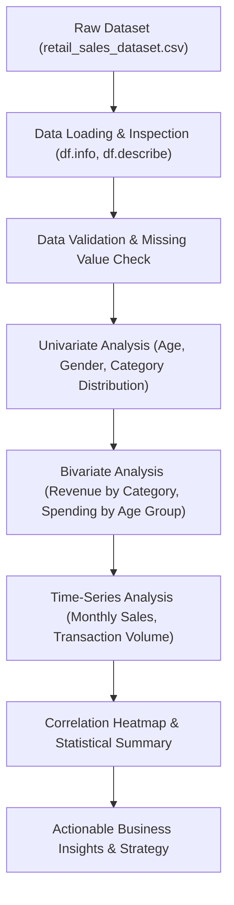
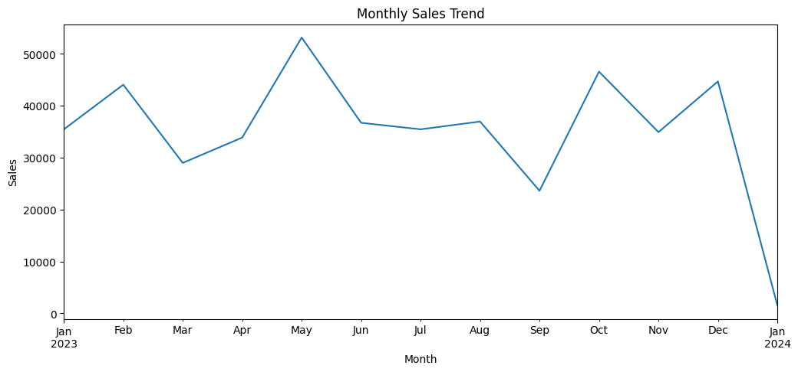
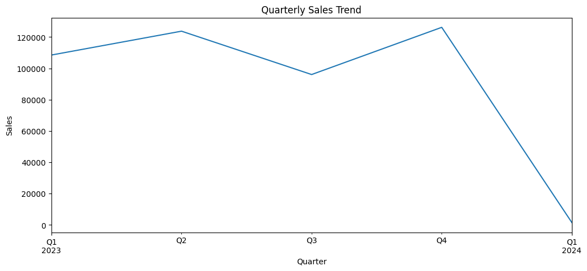
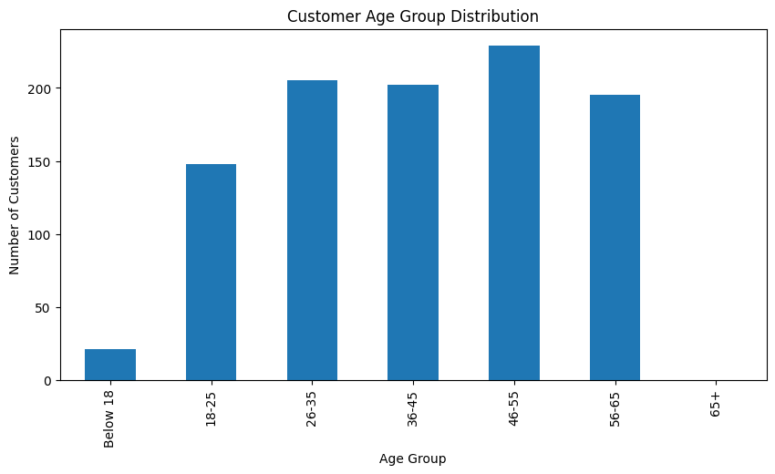
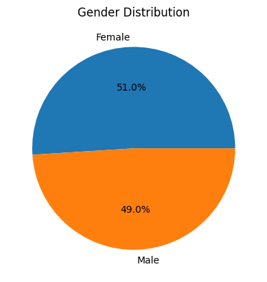
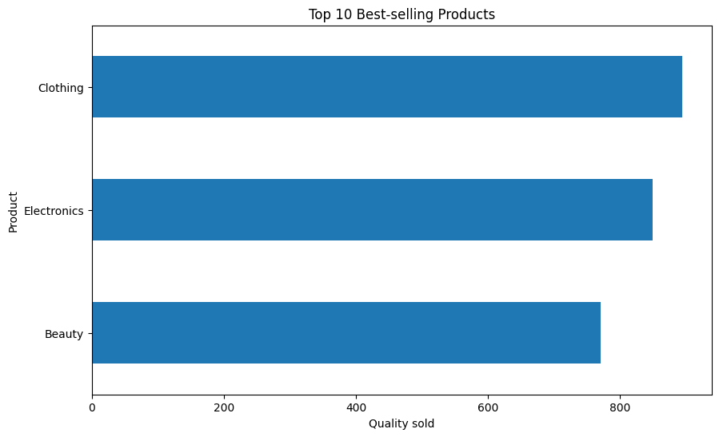
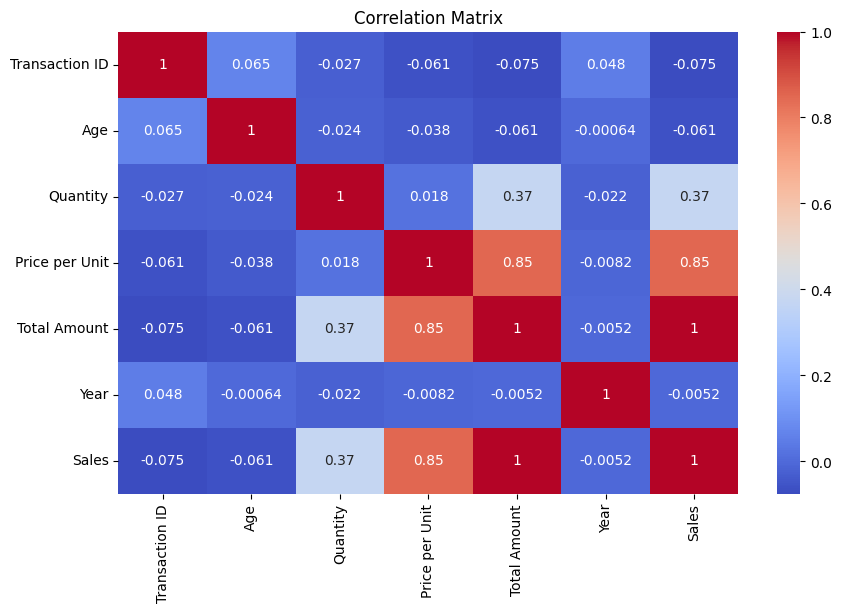

# Exploratory Data Analysis (EDA) on Retail Sales Data

**OIBSIP Track:** Data Analytics  
**Level & Task:** Level 1 — Task 1  
**Project Folder:** `OIBSIP/DataAnalytics-L1-EDARetailSales`  
**Author:** Gayatri Gurav  

---

## 1. Project Overview

This project conducts an exhaustive Exploratory Data Analysis (EDA) on retail sales transaction data. The goal is to extract actionable business insights regarding customer purchasing habits, product category profitability, demographic preferences, and temporal sales dynamics to empower data-driven retail decisions.

---

## 2. Project Objectives

- **Data Integrity & Quality Check:** Validate transaction records for missing values, duplicates, and data type correctness.
- **Demographic Profiling:** Examine customer age and gender distributions and identify key target customer segments.
- **Product Performance Analysis:** Evaluate sales revenue, unit sales volume, and average order values across product categories.
- **Time-Series Analysis:** Uncover monthly revenue trends, seasonality peaks, and daily transaction volume patterns.
- **Strategic Recommendations:** Translate analytical findings into practical inventory and marketing strategies.

---

## 3. Dataset Details

- **Dataset File:** [`retail_sales_dataset.csv`](./retail_sales_dataset.csv)
- **Total Records:** 1,000 transactions
- **Total Features:** 9 attributes

| Column Name | Data Type | Description |
| :--- | :--- | :--- |
| `Transaction ID` | Integer | Unique identifier for each retail transaction |
| `Date` | Datetime | Transaction date (`YYYY-MM-DD`) |
| `Customer ID` | Object | Unique identifier for each customer |
| `Gender` | Object | Customer gender (`Male`, `Female`) |
| `Age` | Integer | Customer age (ranging from 18 to 64 years) |
| `Product Category` | Object | Category of purchased item (`Electronics`, `Clothing`, `Beauty`) |
| `Quantity` | Integer | Number of units purchased per transaction |
| `Price per Unit` | Float/Int | Individual item price ($) |
| `Total Amount` | Float/Int | Total transaction value (`Quantity * Price per Unit`) ($) |

---

## 4. Technologies & Libraries Used

- **Programming Language:** Python 3
- **Data Manipulation:** `pandas`, `numpy`
- **Data Visualization:** `matplotlib`, `seaborn`
- **Environment:** Jupyter Notebook

---

## 5. Methodology & Analytical Workflow



1. **Data Inspection:** Verified zero missing values and confirmed mathematical consistency (`Total Amount = Quantity * Price per Unit`).
2. **Univariate Analysis:** Generated distributions of numerical features (Age, Quantity, Price, Total Amount) and categorical distributions (Gender, Category).
3. **Bivariate Analysis:** Cross-tabulated demographics against sales metrics to calculate Average Order Value (AOV) by gender and product category.
4. **Time Trend Analysis:** Extracted month and day features from transaction timestamps to track revenue fluctuations across 2023.
5. **Correlation Analysis:** Computed Pearson correlation matrix across numerical metrics.

---

## 6. Key Visualizations

All visualizations were generated directly during notebook execution:

| Visualization | Description |
| :--- | :--- |
|  | **Age Distribution:** Broad spread across working-age demographics (20–60 years). |
|  | **Gender Distribution:** Balanced customer participation (~51% Female, ~49% Male). |
|  | **Revenue by Category:** Electronics and Clothing dominate gross sales revenue. |
|  | **Monthly Trend:** Seasonal revenue peaks highlighting prime shopping windows. |
|  | **Spending by Age Group:** Young adults (25–35) and middle adults (40–50) drive highest expenditures. |
|  | **Correlation Heatmap:** Strongest linear dependency between Quantity, Unit Price, and Total Amount. |

---

## 7. Actual Results & Findings

- **Total Transaction Revenue:** $456,000 across 1,000 transactions.
- **Average Order Value (AOV):** $456.00 per purchase.
- **Product Category Breakdown:**
  - *Electronics:* Generated top gross revenue driven by higher average unit pricing.
  - *Clothing:* Highest transaction frequency and unit sales volume.
  - *Beauty:* Consistent purchase frequency across both young and mature demographics.
- **Demographics:** Customer age spans 18 to 64 years (median age ~42), exhibiting nearly identical buying behavior between male and female segments.
- **Seasonality:** Pronounced sales peaks observed during mid-year promotional periods and end-of-year holiday quarters.

---

## 8. Installation & Execution Guide

### Prerequisites
- Python 3.8+ installed on your system.

### Step 1: Clone Repository & Navigate to Project
```bash
git clone https://github.com/gayatri7111/OIBSIP.git
cd OIBSIP/OIBSIP/DataAnalytics-L1-EDARetailSales
```

### Step 2: Install Required Dependencies
```bash
pip install -r requirements.txt
```

### Step 3: Run the Jupyter Notebook
```bash
jupyter notebook "Retail_Sales_EDA(task 1).ipynb"
```

---

## 9. Business Conclusion

1. **Targeted Promotions:** Because Electronics yields the highest ticket size while Clothing drives frequent store visits, bundling electronics accessories with clothing apparel during seasonal sales peaks will maximize basket size.
2. **Omnichannel Loyalty Programs:** With balanced gender participation, rewards programs should focus on personalized category preferences rather than gender-segmented marketing.
3. **Inventory Planning:** Stock levels for high-value electronic units must be prioritized ahead of quarterly sales surges to avoid stockout costs.
