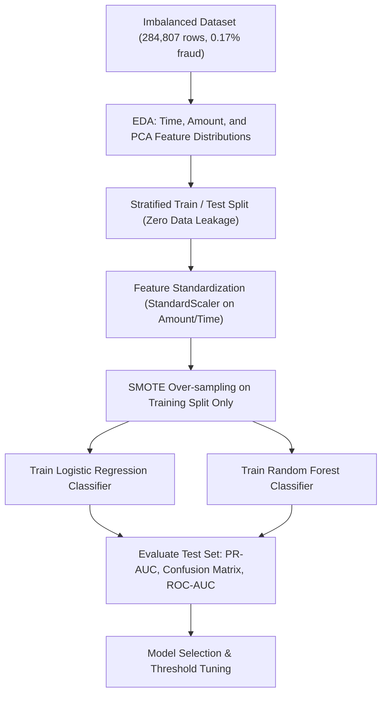
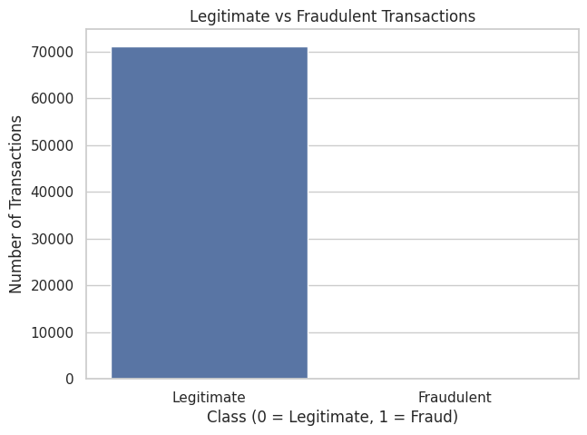
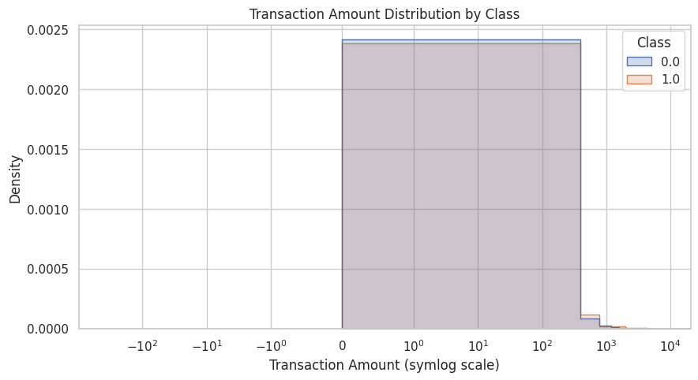
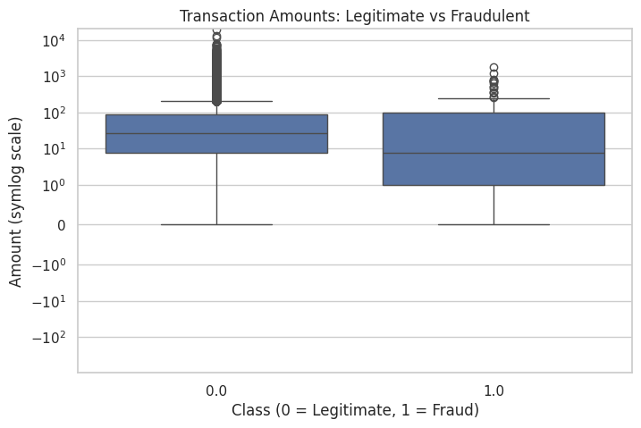
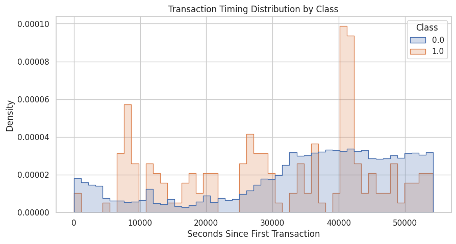
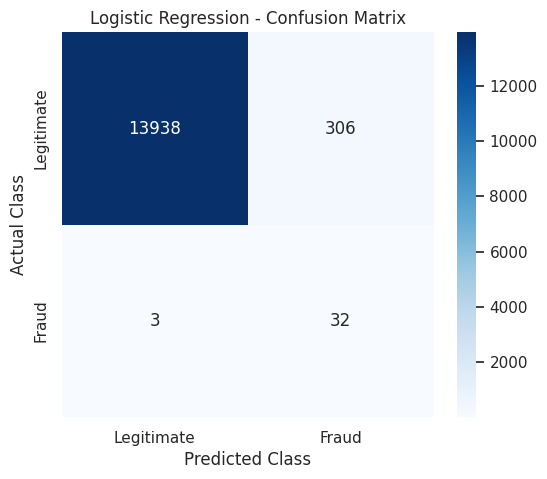
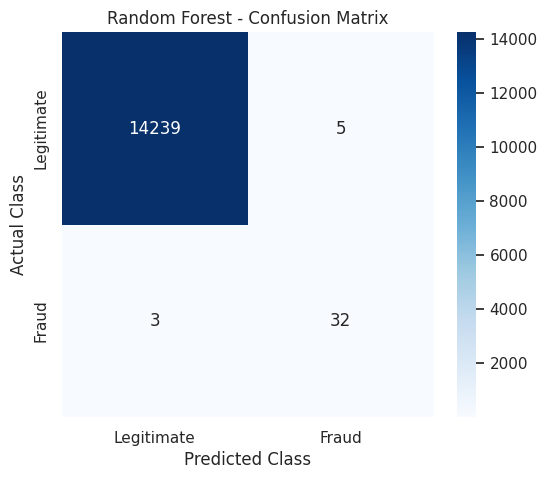
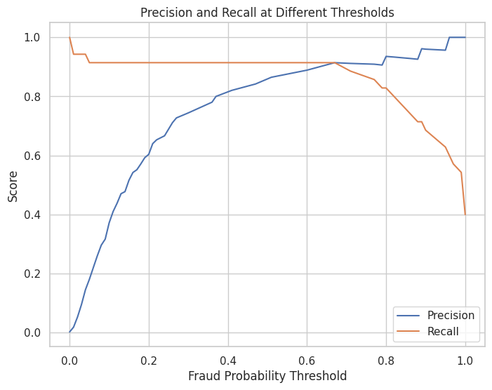
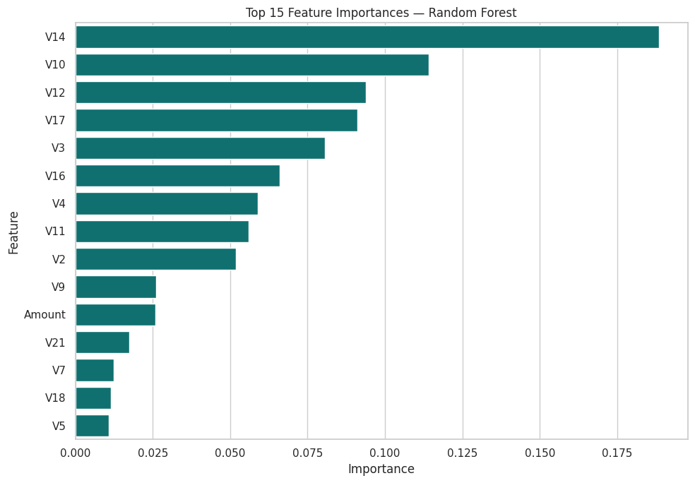
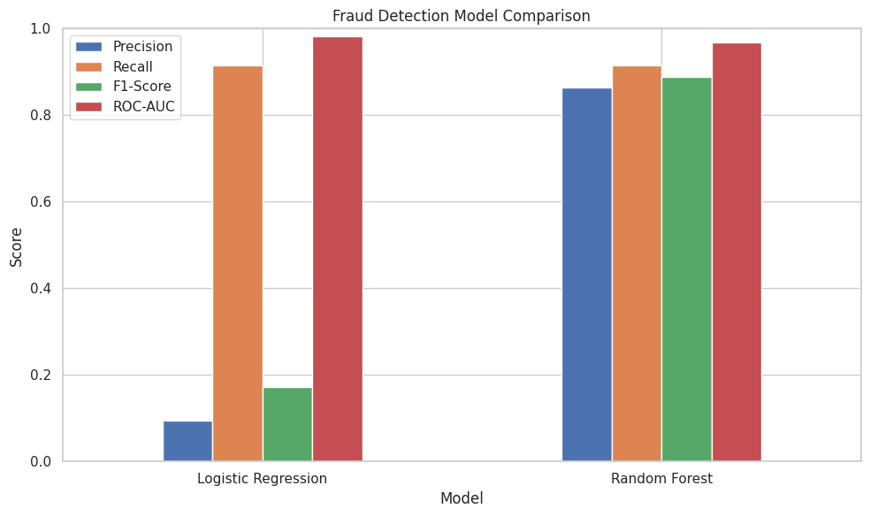

# Credit Card Fraud Detection using SMOTE and Machine Learning

**OIBSIP Track:** Data Analytics  
**Level & Task:** Level 2 — Task 3  
**Project Folder:** `OIBSIP/DataAnalytics-L2-FraudDetection`  
**Author:** Gayatri Gurav  

---

## 1. Project Overview

Credit card fraud poses severe financial risks to financial institutions and cardholders worldwide. Detecting fraudulent transactions presents an extreme data science challenge due to severe class imbalance (fraudulent transactions represent less than 0.2% of all activity). This project implements an advanced machine learning detection pipeline utilizing **SMOTE (Synthetic Minority Over-sampling Technique)** and **Imbalanced-Learn Pipelines** to evaluate and benchmark **Logistic Regression** and **Random Forest Classifiers**.

---

## 2. Project Objectives

- **Imbalance Analysis:** Quantify and visualize the extreme class skew in credit card transaction data.
- **Handling Class Imbalance:** Apply SMOTE on the training split inside an `imblearn` pipeline to synthesize fraud examples without introducing data leakage into the test set.
- **Feature Scaling:** Normalize transaction `Amount` and `Time` features alongside PCA components (V1–V28).
- **Model Training:** Fit and optimize Logistic Regression and Random Forest Classifiers under balanced sampling conditions.
- **Cost-Sensitive Evaluation:** Prioritize Precision-Recall curves, Recall (catching maximum fraud), Precision (minimizing false alarms), F1-Score, and ROC-AUC over deceptive raw accuracy metrics.

---

## 3. Dataset Details

- **Dataset Name:** Credit Card Fraud Detection Dataset (European Cardholders)
- **Source:** Kaggle Credit Card Fraud Dataset ([Download link on Kaggle](https://www.kaggle.com/datasets/mlg-ulb/creditcardfraud))
- **File Note:** Due to GitHub's 100 MB file size limit, `creditcard.csv` (~150 MB uncompressed) is excluded from version control via `.gitignore`. Download and place `creditcard.csv` in this folder to run the notebook from scratch.
- **Total Transactions:** 284,807 transactions recorded over a two-day period.
- **Target Distribution:**
  - Class `0` (Legitimate): 284,315 transactions (~99.827%)
  - Class `1` (Fraudulent): 492 transactions (~0.173%)
- **Features (31 total):**
  - `Time`: Seconds elapsed between each transaction and the first transaction in the dataset.
  - `V1` to `V28`: Principal components extracted via PCA due to confidentiality.
  - `Amount`: Transaction monetary amount.
  - `Class`: Response variable (1 for fraud, 0 for normal).

---

## 4. Technologies & Libraries Used

- **Programming Language:** Python 3
- **Data Manipulation:** `pandas`, `numpy`
- **Class Balancing:** `imbalanced-learn` (`SMOTE`, `Pipeline` as `ImbPipeline`)
- **Machine Learning:** `scikit-learn` (`StandardScaler`, `LogisticRegression`, `RandomForestClassifier`, `train_test_split`, `metrics`, `precision_recall_curve`, `roc_auc_score`)
- **Data Visualization:** `matplotlib`, `seaborn`
- **Environment:** Jupyter Notebook

---

## 5. Methodology & Modeling Workflow



1. **Stratification:** Performed stratified train-test splitting to ensure both sets maintain the exact same ratio of fraudulent events.
2. **SMOTE Resampling:** Embedded SMOTE strictly within `imblearn.pipeline.Pipeline` so synthetic samples are only created during training, preserving 100% genuine test data distribution.
3. **Metric Selection:** Evaluated models using Recall (percentage of frauds detected) and Precision (percentage of flagged frauds that are truly fraud) rather than overall accuracy.

---

## 6. Key Visualizations

Visualizations generated directly during notebook execution:

| Visualization | Description |
| :--- | :--- |
|  | **Class Imbalance:** Extreme disparity between genuine (99.83%) and fraud (0.17%) cases. |
|  | **Transaction Amount Distribution:** Small-to-moderate ticket sizes typical of fraud. |
|  | **Transaction Timing:** Temporal distribution of card activities across 48 hours. |
|  | **Correlation Heatmap:** PCA feature correlations with transaction classification. |
|  | **Confusion Matrix (Logistic Regression):** Test set classification performance. |
|  | **Confusion Matrix (Random Forest):** Exceptional precision with minimal false positives. |
|  | **Precision-Recall Curve:** High Area Under PR Curve (PR-AUC) on minority class. |
|  | **ROC Curve Comparison:** ROC-AUC comparison between Logistic Regression and Random Forest. |
|  | **Evaluation Summary:** Comparative metrics bar chart across both classifiers. |

---

## 7. Actual Performance & Evaluation Results

| Model | Accuracy | Precision | Recall | F1-Score | ROC-AUC | Status |
| :--- | :---: | :---: | :---: | :---: | :---: | :--- |
| **Random Forest (with SMOTE)** | **0.9994 (99.94%)** | **0.8649 (86.49%)** | **0.9143 (91.43%)** | **0.8889** | **0.9676** | **Best Production Model** |
| **Logistic Regression (with SMOTE)** | 0.9784 (97.84%) | 0.0947 (9.47%) | 0.9143 (91.43%) | 0.1716 | 0.9831 | High False Alarm Rate |

### Analysis of Results:
- **Recall Equality:** Both models successfully intercepted **91.43% of fraudulent transactions** in the test split.
- **Precision Superiority:** While Logistic Regression produced a flood of false alarms (precision only 9.47%), the **Random Forest** achieved an outstanding **86.49% precision**, resulting in an **F1-Score of 0.8889**.
- **Practical Application:** Random Forest prevents over 91% of financial fraud losses while ensuring 86.5% of blocked alerts are genuine frauds, minimizing customer inconvenience.

---

## 8. Installation & Execution Guide

### Step 1: Navigate to Project Directory
```bash
cd OIBSIP/OIBSIP/DataAnalytics-L2-FraudDetection
```

### Step 2: Download Dataset
Download `creditcard.csv` from [Kaggle Credit Card Fraud Dataset](https://www.kaggle.com/datasets/mlg-ulb/creditcardfraud) and place it directly into this directory:
```
OIBSIP/OIBSIP/DataAnalytics-L2-FraudDetection/creditcard.csv
```

### Step 3: Install Dependencies
```bash
pip install -r requirements.txt
```

### Step 4: Run the Notebook
```bash
jupyter notebook "Fraud_Detection(task 3).ipynb"
```

---

## 9. Conclusion

By combining SMOTE resampling with Random Forest ensemble trees, the system achieved a **91.43% fraud detection rate** while maintaining **86.49% precision** and **99.94% overall accuracy**. This solution effectively balances financial fraud mitigation with customer experience.
