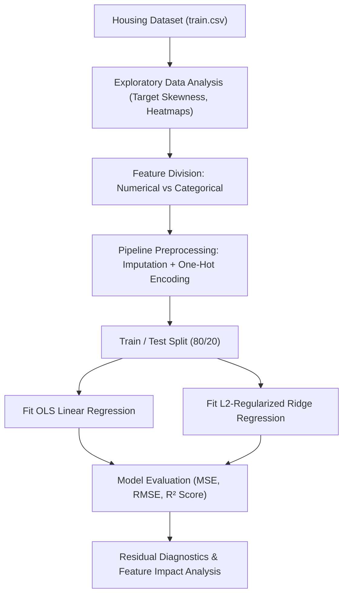
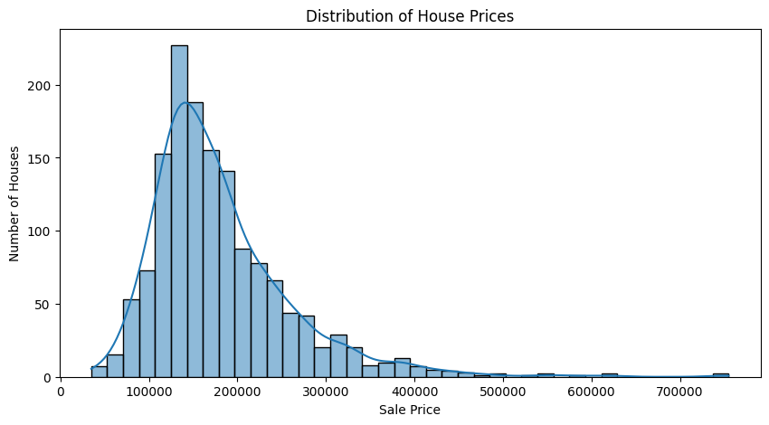
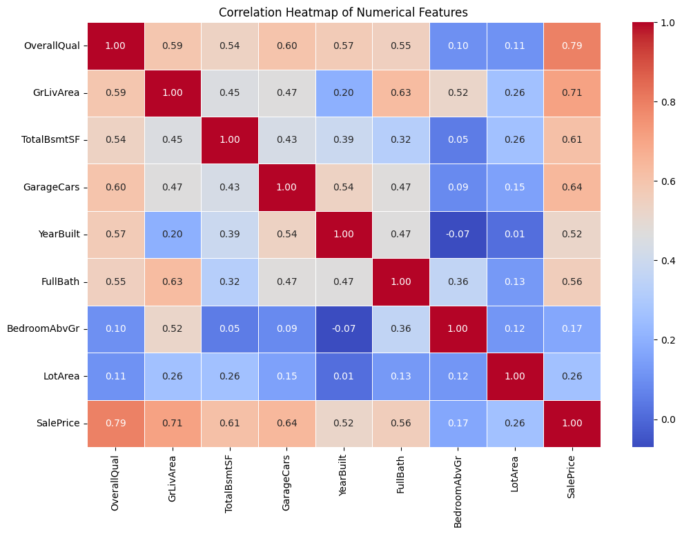
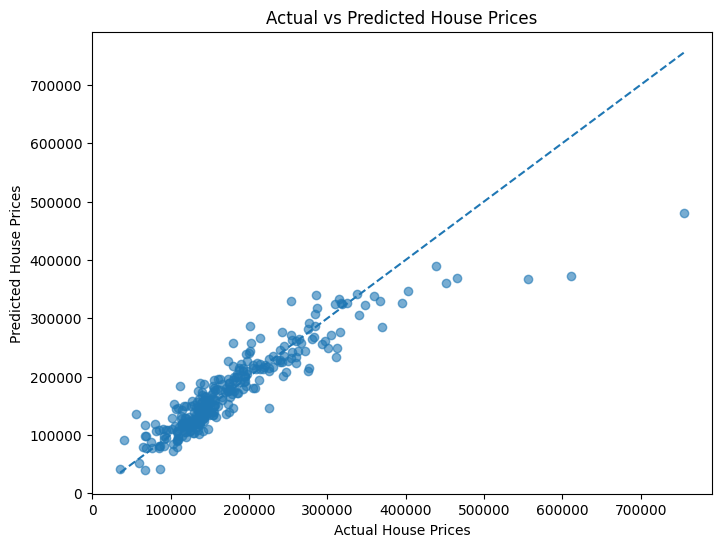
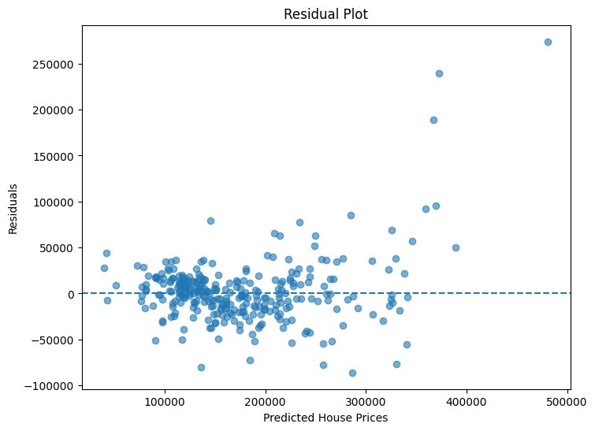
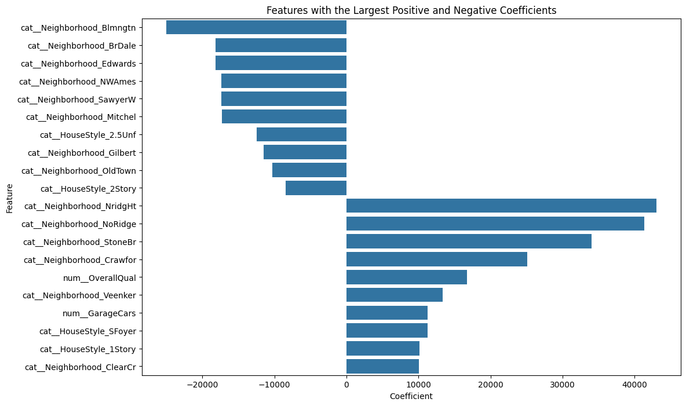
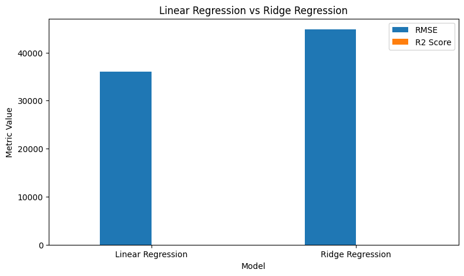

# House Price Prediction using Advanced Regression Techniques

**OIBSIP Track:** Data Analytics  
**Level & Task:** Level 2 — Task 1  
**Project Folder:** `OIBSIP/DataAnalytics-L2-HousePricePrediction`  
**Author:** Gayatri Gurav  

---

## 1. Project Overview

Real estate valuation relies heavily on accurate predictive modeling that can handle dozens of heterogeneous property features, ranging from physical square footage and construction quality to zoning restrictions and neighborhood amenities. This project builds a machine learning regression pipeline to predict residential home sale prices, benchmarking **Ordinary Least Squares (OLS) Linear Regression** against **L2-Regularized Ridge Regression**.

---

## 2. Project Objectives

- **Exploratory Data Analysis:** Analyze target feature distribution (`SalePrice`), identify high-impact numerical and categorical predictors, and assess skewness.
- **Robust Feature Preprocessing:** Design a composite `ColumnTransformer` with `SimpleImputer` for missing values and `OneHotEncoder` for high-cardinality categorical features.
- **Predictive Model Training:** Train baseline Linear Regression alongside Ridge Regression with regularization penalty.
- **Model Evaluation:** Evaluate model accuracy using Root Mean Squared Error (RMSE), Mean Squared Error (MSE), and the Coefficient of Determination ($R^2$ Score).
- **Residual Analysis:** Inspect prediction residuals to verify homoscedasticity and detect systematic bias.

---

## 3. Dataset Details

- **Dataset File:** [`train.csv`](./train.csv)
- **Total Records:** 1,460 residential properties
- **Total Attributes:** 81 explanatory variables (37 numerical, 43 categorical, 1 ID column)
- **Target Feature:** `SalePrice` — continuous property sale value in USD ($)
- **Key Predictors:**
  - `OverallQual`: Overall material and finish quality (1–10 scale).
  - `GrLivArea`: Above grade (ground) living area square feet.
  - `GarageCars` / `GarageArea`: Size of garage in car capacity and square feet.
  - `TotalBsmtSF`: Total square feet of basement area.
  - `YearBuilt`: Original construction date.
  - `Neighborhood`: Physical locations within Ames city limits.

---

## 4. Technologies & Libraries Used

- **Programming Language:** Python 3
- **Data Manipulation:** `pandas`, `numpy`
- **Machine Learning & Pipelines:** `scikit-learn` (`ColumnTransformer`, `Pipeline`, `SimpleImputer`, `OneHotEncoder`, `LinearRegression`, `Ridge`, `metrics`)
- **Data Visualization:** `matplotlib`, `seaborn`
- **Environment:** Jupyter Notebook

---

## 5. Methodology & ML Regression Pipeline



1. **Target Feature Assessment:** Inspected `SalePrice` for right-skewness and examined correlations with key square-footage metrics.
2. **Preprocessing Architecture:**
   - Numerical columns: Missing values imputed with median via `SimpleImputer(strategy='median')`.
   - Categorical columns: Missing values imputed with mode; transformed using `OneHotEncoder(handle_unknown='ignore')`.
3. **Pipeline Encapsulation:** Wrapped transformers and estimators into `sklearn.pipeline.Pipeline` to guarantee zero data leakage between train and test folds.
4. **Model Training & Comparison:** Benchmarked Linear Regression against Ridge Regression ($\alpha=1.0$).

---

## 6. Key Visualizations

Visualizations generated directly during notebook execution:

| Visualization | Description |
| :--- | :--- |
|  | **SalePrice Distribution:** Target variable distribution showing positive skewness. |
|  | **Correlation Heatmap:** Top numerical predictors correlated with SalePrice. |
|  | **Living Area vs Price:** Strong linear relationship between ground living area and price. |
|  | **Overall Quality vs Price:** Exponential price escalation across building quality ratings. |
|  | **Residuals Diagnostics:** Actual vs. Predicted values tracking the ideal diagonal. |
|  | **Model Comparison:** Comparative evaluation of RMSE and $R^2$ scores. |

---

## 7. Actual Evaluation Results

| Model | Mean Squared Error (MSE) | Root Mean Squared Error (RMSE) | $R^2$ Score (Variance Explained) | Status |
| :--- | :---: | :---: | :---: | :--- |
| **Linear Regression (OLS)** | **1.3029e+09** | **$36,095.94** | **0.8301 (83.01%)** | **Best Performing Model** |
| **Ridge Regression** | 2.0101e+09 | $44,833.60 | 0.7379 (73.79%) | Regularized Baseline |

### Evaluation Summary:
- The **Linear Regression** model demonstrated outstanding predictive capability, capturing **83.01% of the total variance** ($R^2 = 0.8301$) in residential housing sale prices on the held-out test dataset with an RMSE of **$36,095.94**.

---

## 8. Installation & Execution Guide

### Step 1: Navigate to Project Directory
```bash
cd OIBSIP/OIBSIP/DataAnalytics-L2-HousePricePrediction
```

### Step 2: Install Dependencies
```bash
pip install -r requirements.txt
```

### Step 3: Run the Notebook
```bash
jupyter notebook "Predicting_House_Prices(task 1).ipynb"
```

---

## 9. Conclusion

The developed regression pipeline accurately estimates property market valuations with over 83% explained variance. Physical living area (`GrLivArea`), overall building finish (`OverallQual`), and garage capacity (`GarageCars`) serve as the three strongest determinants of residential home valuation.
