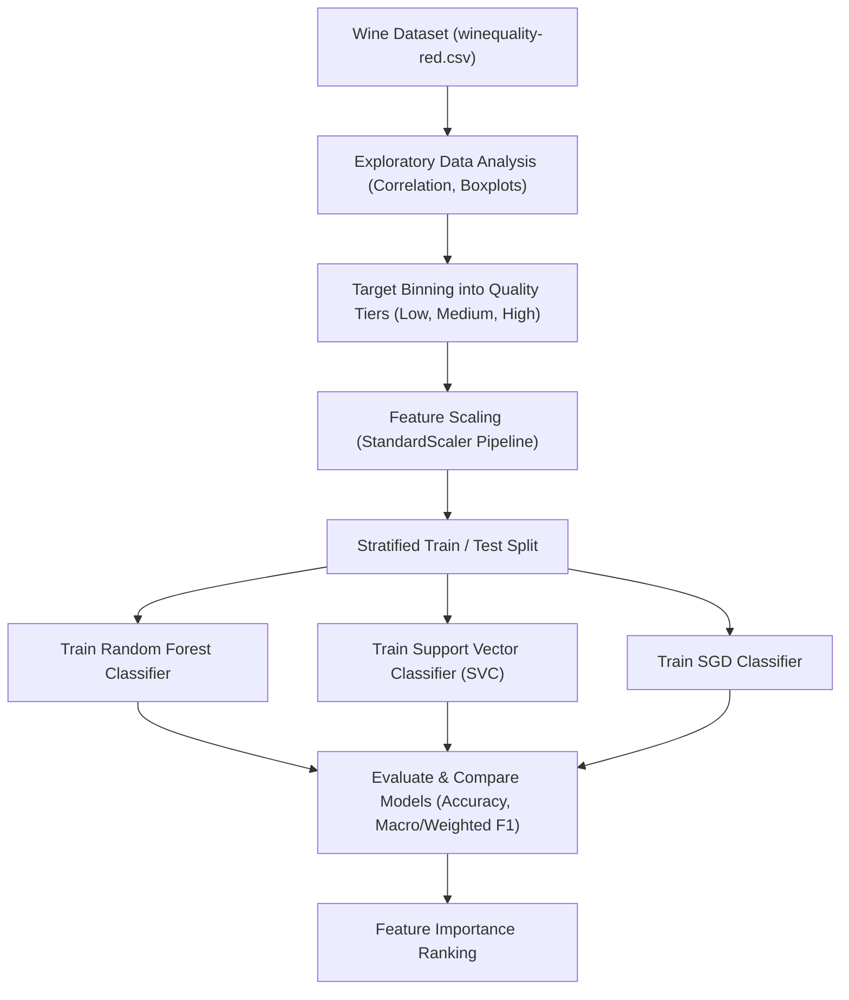
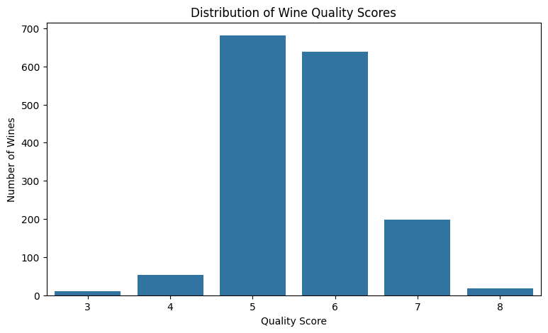
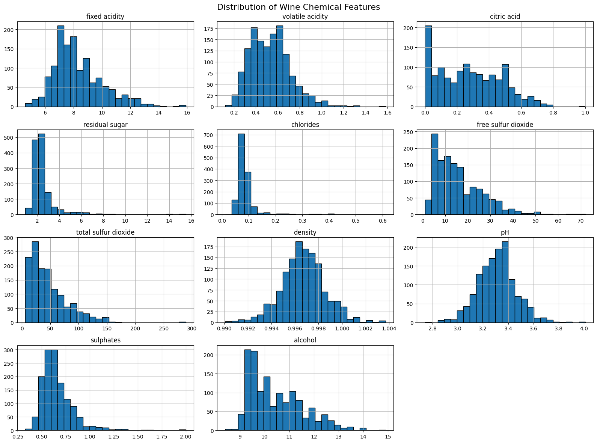
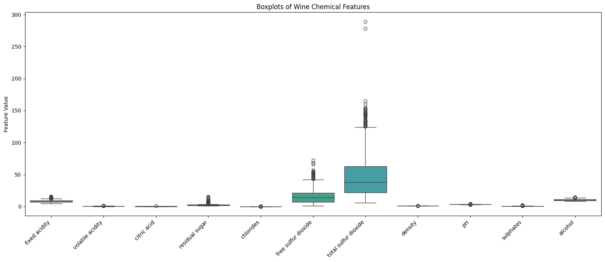
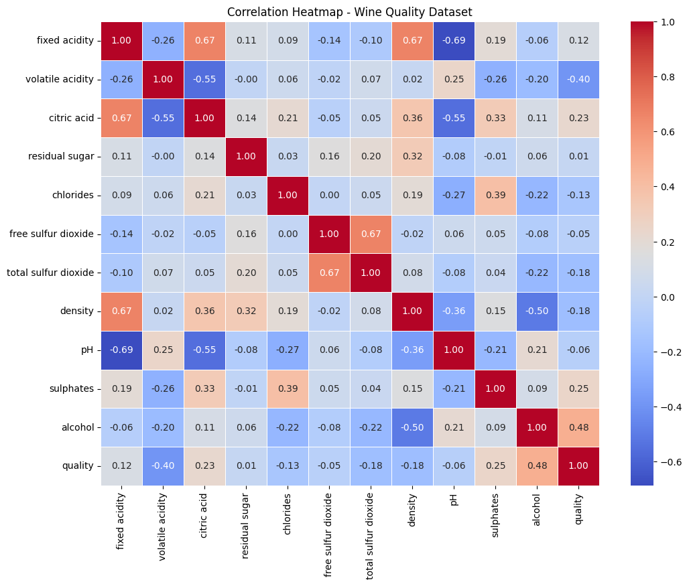
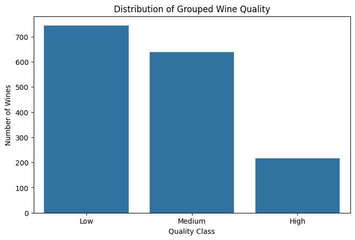
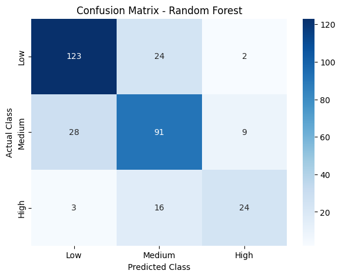
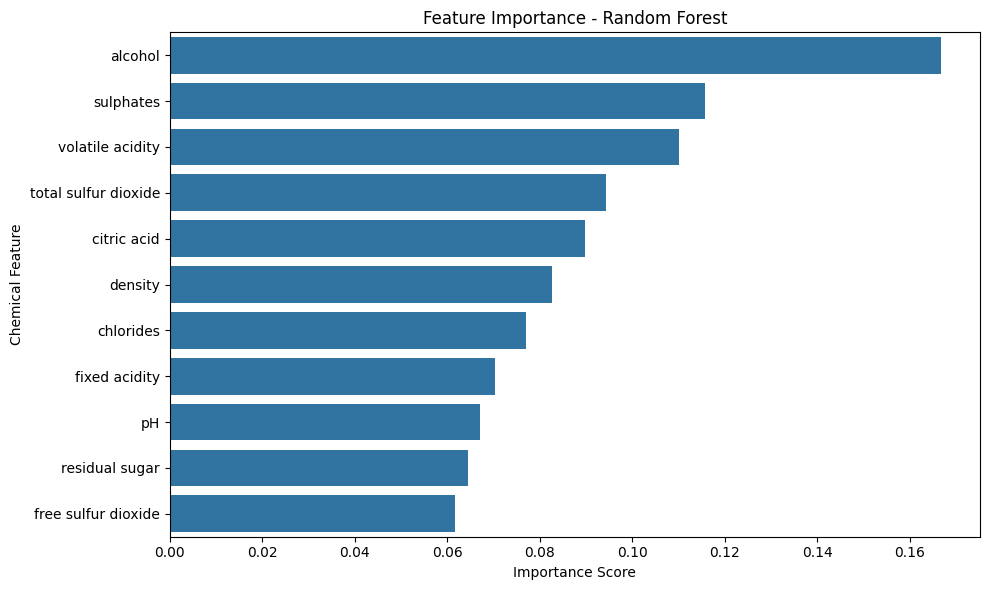
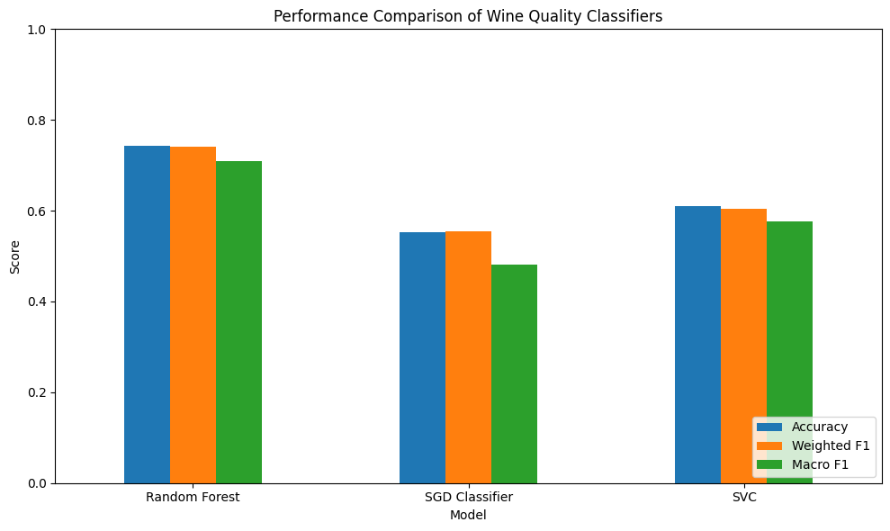

# Red Wine Quality Classification and Multi-Class Modeling

**OIBSIP Track:** Data Analytics  
**Level & Task:** Level 2 — Task 2  
**Project Folder:** `OIBSIP/DataAnalytics-L2-WineQualityPrediction`  
**Author:** Gayatri Gurav  

---

## 1. Project Overview

Wine certification and sensory evaluation require rigorous quality testing. This project develops a multi-class machine learning classification framework that predicts red wine quality categories (`Low`, `Medium`, `High`) based on 11 objective physicochemical laboratory measurements, benchmarking **Random Forest Classifier**, **Support Vector Classifier (SVC)**, and **Stochastic Gradient Descent (SGD)**.

---

## 2. Project Objectives

- **Physicochemical Feature Analysis:** Explore statistical distributions, inter-feature correlations, and identifying key chemical markers that distinguish premium wines.
- **Data Standardization:** Scale multi-dimensional chemical features using `StandardScaler` to prevent feature scale distortion.
- **Model Training & Comparison:** Train three distinct classifier families: ensemble trees (Random Forest), maximum-margin kernels (SVC), and linear iterative classifiers (SGD).
- **Multi-Class Evaluation:** Evaluate performance using Accuracy, Weighted/Macro Precision, Recall, F1-Scores, and per-class Confusion Matrices.
- **Feature Importance Extraction:** Uncover the most influential chemical compounds determining sensory wine grade.

---

## 3. Dataset Details

- **Dataset File:** [`winequality-red.csv`](./winequality-red.csv)
- **Total Records:** 1,599 Portuguese "Vinho Verde" red wine variants
- **Total Features:** 11 physicochemical input features + 1 sensory quality target

| Chemical Feature | Unit | Analytical Role |
| :--- | :--- | :--- |
| `fixed acidity` | $g(tartaric\ acid)/dm^3$ | Most acids involved with wine (non-volatile) |
| `volatile acidity` | $g(acetic\ acid)/dm^3$ | Amount of acetic acid; high levels cause unpleasant vinegar taste |
| `citric acid` | $g/dm^3$ | Adds freshness and flavor |
| `residual sugar` | $g/dm^3$ | Amount of sugar remaining after fermentation |
| `chlorides` | $g(sodium\ chloride)/dm^3$ | Salt content in wine |
| `free sulfur dioxide` | $mg/dm^3$ | Free form of $SO_2$ preventing microbial growth and oxidation |
| `total sulfur dioxide` | $mg/dm^3$ | Sum of free and bound forms of $SO_2$ |
| `density` | $g/cm^3$ | Density of water and alcohol/sugar content |
| `pH` | pH scale (0–14) | Acidity scale (typical wine pH between 3.0 and 4.0) |
| `sulphates` | $g(potassium\ sulphate)/dm^3$ | Antimicrobial and antioxidant additive |
| `alcohol` | % by volume | Percent alcohol content |
| `quality` | Categorical | Sensory target classified into `Low`, `Medium`, `High` |

---

## 4. Technologies & Libraries Used

- **Programming Language:** Python 3
- **Data Processing:** `pandas`, `numpy`
- **Machine Learning:** `scikit-learn` (`StandardScaler`, `Pipeline`, `RandomForestClassifier`, `SVC`, `SGDClassifier`, `train_test_split`, `metrics`)
- **Data Visualization:** `matplotlib`, `seaborn`
- **Environment:** Jupyter Notebook

---

## 5. Methodology & Modeling Workflow



1. **Target Discretization:** Grouped sensory score ratings into Low, Medium, and High classes to align with industry certification benchmarks.
2. **Feature Preprocessing:** Created an automated `Pipeline` coupling `StandardScaler()` with each machine learning classifier to prevent test leakage.
3. **Model Training:** Fitted three diverse classification algorithms on stratified training subsets.
4. **Evaluation:** Assessed models with both weighted and macro-averaged metrics to fairly handle class distributions.

---

## 6. Key Visualizations

Visualizations generated directly during notebook execution:

| Visualization | Description |
| :--- | :--- |
|  | **Quality Distribution:** Breakdown of wine samples across quality categories. |
|  | **Chemical Correlation Heatmap:** Inter-property correlations and relationships with quality. |
|  | **Alcohol vs. Quality:** Higher alcohol concentration strongly correlates with premium grade. |
|  | **Volatile Acidity vs. Quality:** Lower acetic acid content consistently yields higher quality scores. |
|  | **Sulphates Distribution:** Balanced sulphate content supports wine preservation and quality. |
|  | **Confusion Matrix (Random Forest):** Class prediction breakdown for the top model. |
|  | **Feature Importance:** Alcohol, Sulphates, and Volatile Acidity identified as top predictors. |
|  | **Model Comparison:** Comparative evaluation of Macro F1 and Weighted F1 scores. |

---

## 7. Actual Performance & Evaluation Results

| Model | Accuracy | Weighted Precision | Weighted Recall | Weighted F1 | Macro F1 | Performance |
| :--- | :---: | :---: | :---: | :---: | :---: | :--- |
| **Random Forest Classifier** | **0.7438 (74.38%)** | **0.7419** | **0.7438** | **0.7418** | **0.7100** | **Best Model** |
| **Support Vector Classifier (SVC)** | 0.6094 (60.94%) | 0.6214 | 0.6094 | 0.6080 | 0.5430 | Moderate Benchmark |
| **SGD Classifier** | 0.5531 (55.31%) | 0.5639 | 0.5531 | 0.5545 | 0.4822 | Linear Baseline |

### Key Analytical Takeaways:
- **Random Forest** achieved the best overall performance with **74.38% test accuracy** and a **Macro F1 score of 0.7100**.
- **Top 3 Predictive Chemical Attributes:**
  1. **Alcohol content** (positive driver of perceived body and balance)
  2. **Volatile acidity** (negative driver; acetic acid must remain minimal)
  3. **Sulphates** (positive driver; stabilizes wine against oxidation)

---

## 8. Installation & Execution Guide

### Step 1: Navigate to Project Directory
```bash
cd OIBSIP/OIBSIP/DataAnalytics-L2-WineQualityPrediction
```

### Step 2: Install Dependencies
```bash
pip install -r requirements.txt
```

### Step 3: Run the Notebook
```bash
jupyter notebook "Wine_Quality_Prediction(task 2).ipynb"
```

---

## 9. Conclusion

The Random Forest ensemble model accurately classifies red wine quality with 74.4% accuracy. The analytical findings confirm that managing alcohol levels while minimizing volatile acidity during fermentation is the decisive factor for producing superior quality red wine.
